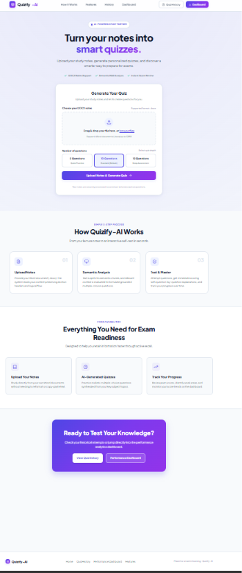
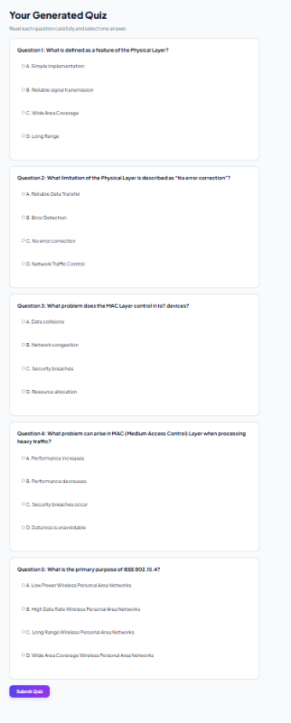
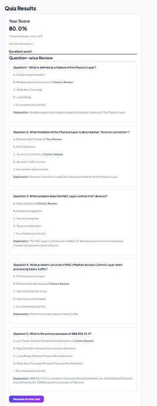
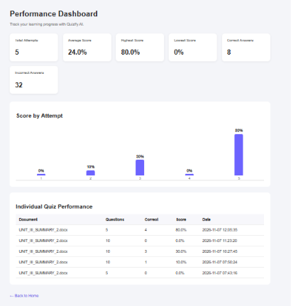

# Quizify-AI – AI-Powered Quiz Generator

Transform your study notes into interactive multiple-choice quizzes using AI.

Quizify-AI is a web-based study platform built with Python and Flask that converts Microsoft Word study notes into structured MCQ quizzes. It supports both **Google Gemini for cloud-based AI generation** and **Ollama for local AI inference**, with question validation, automatic scoring, attempt history, and performance analytics.

🚀 **[Live Demo](https://quizify-ai-or8w.onrender.com)** | 💻 **[GitHub Repository](https://github.com/AkankshaD2/Quizify-AI)**

---

## ✨ Key Features

- **DOCX Document Upload:** Upload Microsoft Word study notes through a simple drag-and-drop interface.
- **Intelligent Document Processing:** Extracts, cleans, and organizes document content into meaningful sections and chunks.
- **Dual AI Provider Support:** Generate questions using Google Gemini API or locally hosted Ollama with Llama 3.2.
- **Structured MCQ Generation:** Generates multiple-choice questions with four options, correct answers, and explanations.
- **Question Validation:** Uses Pydantic schemas and validation checks to improve question structure and answer quality.
- **Configurable Quiz Length:** Choose between 5, 10, or 15 questions per session.
- **Automatic Scoring:** Calculates scores and displays correct answers with explanations.
- **Quiz History:** Stores previous quiz attempts using SQLite.
- **Performance Dashboard:** Displays quiz statistics, score trends, and historical performance.

---

## 📸 Screenshots

### 1. Homepage – Document Upload



Upload study notes and select the number of questions to generate.

### 2. Interactive Quiz Interface



Attempt AI-generated multiple-choice questions in an interactive interface.

### 3. Results and Explanations



View your score, correct answers, and question-wise explanations.

### 4. Performance Dashboard



Track previous attempts and monitor quiz performance.

---

## 🛠️ Technology Stack

| Component            | Technologies          |
| -------------------- | --------------------- |
| Programming Language | Python                |
| Backend Framework    | Flask                 |
| AI – Cloud           | Google Gemini API     |
| AI – Local           | Ollama, Llama 3.2     |
| Document Processing  | python-docx           |
| Data Validation      | Pydantic              |
| Database             | SQLite                |
| Frontend             | HTML, CSS, JavaScript |
| Deployment           | Render                |
| Version Control      | Git, GitHub           |

---

## ⚙️ How It Works

Quizify-AI follows a document-to-quiz generation workflow.

```text
       User Uploads DOCX Notes
                 |
                 v
       Document Processing
                 |
                 v
       Text Extraction & Cleaning
                 |
                 v
       Content Structuring
                 |
                 v
        Intelligent Chunking
                 |
                 v
          AI Question Generation
                 |
          +------+------+
          |             |
          v             v
      Gemini API      Ollama
          |          (Llama 3.2)
          |             |
          +------+------+
                 |
                 v
        Question Validation
                 |
                 v
         Interactive Quiz
                 |
                 v
          Answer Submission
                 |
                 v
          Score Calculation
                 |
                 v
        Results & Explanations
                 |
                 v
       SQLite History & Dashboard
```

### Workflow Explanation

1. **Document Upload:** The user uploads study notes in DOCX format.
2. **Text Extraction:** The application extracts paragraphs and relevant document structure.
3. **Content Processing:** Extracted content is cleaned, organized, and divided into meaningful chunks.
4. **AI Generation:** The selected AI provider generates MCQs from the processed content.
5. **Validation:** Generated questions are checked for schema compliance, option structure, answer validity, and other quality constraints.
6. **Quiz Attempt:** The user answers the generated questions through the web interface.
7. **Scoring:** Submitted answers are evaluated and a score is calculated.
8. **History and Analytics:** Quiz attempts are stored in SQLite and displayed through the dashboard.

---

## 🤖 AI Provider Configuration

Quizify-AI supports two AI providers.

| Feature   | Gemini                    | Ollama                                       |
| --------- | ------------------------- | -------------------------------------------- |
| Inference | Cloud-based               | Local                                        |
| Model     | Configurable Gemini model | Llama 3.2                                    |
| API Key   | Required                  | Not required                                 |
| Internet  | Required                  | Not required for inference after model setup |
| Execution | Hosted API                | Local machine                                |

The deployed Render application is configured to use Gemini. Local execution can use either provider, depending on the environment configuration.

---

## 🚀 Live Deployment

The application is deployed using Render.

**Live application:** [https://quizify-ai-or8w.onrender.com](https://quizify-ai-or8w.onrender.com)

### Render Configuration

| Setting       | Value                                    |
| ------------- | ---------------------------------------- |
| Runtime       | Python 3                                 |
| Build Command | `pip install -r requirements-render.txt` |
| Start Command | `gunicorn app:app`                       |
| Branch        | `updated-project`                        |

### Environment Variables

Configure the following environment variables in the Render dashboard:

```text
AI_PROVIDER=gemini
GEMINI_MODEL=gemini-3.5-flash-lite
GEMINI_API_KEY=your_gemini_api_key
SECRET_KEY=your_secure_secret_key
```

Keep API keys and secret values private. Never commit them to GitHub.

---

## 💻 Local Installation and Setup

### Prerequisites

- Python 3.10 or later
- Git
- Google Gemini API key (for Gemini inference), or Ollama (for local inference)

### Step 1: Clone the Repository

```powershell
git clone https://github.com/AkankshaD2/Quizify-AI.git
cd Quizify-AI
```

### Step 2: Create a Virtual Environment

```powershell
python -m venv .venv
.\.venv\Scripts\Activate.ps1
```

### Step 3: Install Dependencies

```powershell
pip install -r requirements.txt
```

For Gemini-based execution, configure the environment variables:

```powershell
$env:AI_PROVIDER="gemini"
$env:GEMINI_MODEL="gemini-3.5-flash-lite"
$env:GEMINI_API_KEY="your_gemini_api_key"
$env:SECRET_KEY="your_secure_secret_key"
```

For local Ollama execution, install Ollama and download Llama 3.2:

```powershell
ollama pull llama3.2
```

Configure the application to use Ollama according to its local AI provider settings.

### Step 4: Run the Application

```powershell
python app.py
```

Open your browser:

```text
http://127.0.0.1:5000
```

---

## 📖 How to Use

1. Open the application.
2. Upload your study notes in `.docx` format.
3. Select the desired question count: 5, 10, or 15.
4. Generate your quiz.
5. Attempt the multiple-choice questions.
6. Submit your answers to view your score and explanations.
7. Visit the History and Dashboard pages to review previous attempts and performance.

---

## 📁 Project Structure

```text
Quizify-AI/
│
├── app.py
├── ai_provider.py
├── requirements.txt
├── requirements-render.txt
│
├── document_processing/
│   ├── docx_reader.py
│   ├── cleaner.py
│   ├── chunker.py
│   ├── structure_builder.py
│   ├── structure_detector.py
│   ├── embedding_generator.py
│   ├── retriever.py
│   └── vector_store.py
│
├── quiz_generation/
│   ├── question_generator.py
│   ├── quiz_schema.py
│   ├── quiz_service.py
│   ├── quiz_validator.py
│   └── ai_provider.py
│
├── quiz_scoring/
│   ├── answer_checker.py
│   ├── score_calculator.py
│   └── scoring_service.py
│
├── database/
│   └── db_manager.py
│
├── templates/
│   ├── index.html
│   ├── quiz.html
│   ├── result.html
│   ├── dashboard.html
│   └── history.html
│
├── static/
│   └── style.css
│
├── docs/
│   └── screenshots/
│       ├── homepage.png
│       ├── quiz.png
│       ├── result.png
│       └── dashboard.png
│
└── README.md
```

---

## ⚠️ Current Limitations

- Currently supports Microsoft Word `.docx` documents only.
- Quiz generation quality depends on the selected AI model and source document quality.
- The hosted free-tier deployment may take some time to respond after inactivity.
- The deployed SQLite database and uploaded files use the hosting environment's filesystem; data may not persist across certain redeployments or instance replacements.

---

## 🔮 Future Improvements

- PDF document support.
- Additional AI model integrations.
- Improved question difficulty classification.
- More detailed learning analytics.
- Persistent cloud database and file storage.
- Exportable quizzes and results.

---

## 👩‍💻 Author

**Akanksha Mangesh Deshmukh**

Computer Engineering Student | Aspiring AI/ML Engineer

- GitHub: [AkankshaD2](https://github.com/AkankshaD2)
- Project: [Quizify-AI](https://github.com/AkankshaD2/Quizify-AI)
- Live Demo: [Quizify-AI](https://quizify-ai-or8w.onrender.com)

---

\<p align="center">   \<strong>Built with Python, Flask, and AI.\</strong> \</p>
