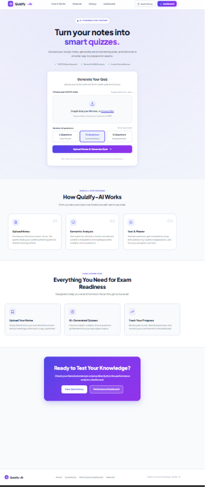
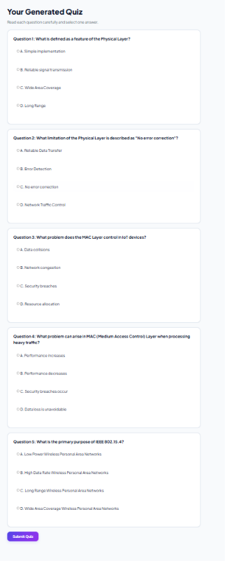
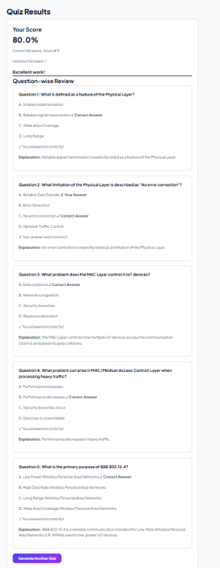
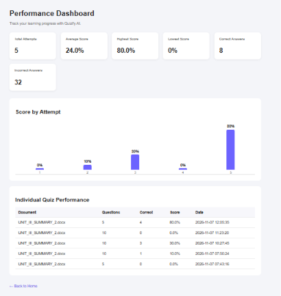

# Quizify-AI

> Local, AI-powered quiz generation platform transforming your study notes into grounded, multiple-choice quizzes.

Quizify-AI is a Retrieval-Augmented Generation (RAG) study platform built with Flask, Python, SQLite, Sentence Transformers, and Ollama (Llama 3.2). Instead of blindly prompting a language model to invent questions from raw text, Quizify-AI extracts and structures your study notes, creates semantic text chunks, generates vector embeddings, retrieves context-relevant material, and validates every generated question against source facts before presenting it to you.

---

## Key Features

- **Document Ingestion (DOCX):** Parses Microsoft Word documents (`.docx`), extracts text paragraphs, removes noise, and identifies structural sections (definitions, features, advantages, and limitations).
- **Intelligent Chunking:** Partitions source documents into logically coherent chunks while preserving unit, topic, and section metadata.
- **Semantic Vector Retrieval:** Uses Sentence Transformers (`all-MiniLM-L6-v2`) to produce 384-dimensional embeddings and calculates cosine similarity via NumPy to match key concepts.
- **Local AI Question Generation:** Employs a locally hosted Llama 3.2 model via Ollama to generate grounded, 4-option multiple-choice questions without sending study data to third-party cloud APIs.
- **Configurable Quiz Lengths:** Select between **5**, **10**, or **15** questions per quiz session based on document depth and study goals.
- **Deterministic & Structural Validation:** Checks generated questions for schema compliance, unique options (A, B, C, D), valid answer keys, grounded explanations, and verified numeric quantities before acceptance.
- **Instant Scoring & Question Review:** Evaluates submitted answers, calculates score percentages, and displays answer keys alongside grounded explanations.
- **Attempt History & Analytics Dashboard:** Automatically records every quiz attempt in SQLite and presents a visual performance dashboard with score charts and historical trends.

---

## Screenshots

<!-- Add your screenshots in an assets/ or docs/ folder and link them below -->

### 1. Homepage & Upload Studio

*Drag-and-drop DOCX upload studio with question count selection (5, 10, 15).*

### 2. Interactive Quiz Interface

*Interactive multiple-choice quiz session generated directly from uploaded lecture notes.*

### 3. Results & Explanations Review

*Instant scoring breakdown, answer verification, and question-by-question explanations.*

### 4. Performance Analytics Dashboard

*Performance dashboard displaying average scores, attempt charts, and historical test logs.*

---

## Technologies Used

| Layer | Technologies |
| :--- | :--- |
| **Backend Framework** | Python 3, Flask, Werkzeug |
| **Document Processing** | python-docx |
| **Embeddings & Search** | Sentence Transformers (`all-MiniLM-L6-v2`), NumPy |
| **LLM Inference** | Ollama, Llama 3.2 (local inference) |
| **Data Validation** | Pydantic |
| **Database** | SQLite3 |
| **Frontend** | HTML5, CSS3 (Modern SaaS design system), Vanilla JavaScript |

---

## How It Works (Pipeline Details)

Quizify-AI operates as a full Retrieval-Augmented Generation (RAG) pipeline:

1. **Document Processing & Structure Detection**
   - The user uploads notes in `.docx` format.
   - Paragraphs are extracted, cleaned of redundant formatting, and parsed to detect hierarchical markers such as Units, Topics, and Sections (Definitions, Features, Advantages, Limitations).
2. **Intelligent Chunking**
   - Content is segmented into structured chunks. Each chunk retains metadata describing its parent topic, unit, and section type.
3. **Embeddings & Vector Indexing**
   - The chunks are converted into 384-dimensional dense vectors using the `all-MiniLM-L6-v2` Sentence Transformer model.
   - An in-memory vector store computes NumPy cosine similarity for semantic matching.
4. **Local LLM Question Generation**
   - The system feeds structured chunk contexts into Ollama running the `llama3.2` model.
   - Pydantic models enforce structured JSON output comprising a question prompt, four distinct options (A, B, C, D), the correct answer key, and an explanation.
5. **Multi-Step Grounding & Validation**
   - Each generated question undergoes strict validation:
     - **Structural integrity:** Verifies that all four options are present, non-empty, and distinct.
     - **Numeric grounding:** Ensures numbers, measurements, and quantities mentioned in the question stem or correct answer exist in the source chunk.
     - **Fact grounding:** Verifies that the correct answer and explanation are directly substantiated by the notes.
     - **Section alignment:** Ensures feature, advantage, and limitation questions accurately reflect the structural context.
   - Unvalidated or hallucinated questions are rejected and regenerated up to maximum retry limits.
6. **Scoring & Persistence**
   - The user submits their answers, which are scored against the session answer key.
   - The quiz results (filename, total questions, correct count, percentage score, and timestamp) are stored in SQLite (`database/quizify.db`).

---

## System Architecture

```text
+---------------------------------------------------------+
|                  User Browser (Web UI)                  |
|  - DOCX Upload Dropzone                                 |
|  - Quiz Length Selection (5, 10, 15 Questions)          |
|  - Interactive Quiz Session & Performance Dashboard     |
+----------------------------+----------------------------+
                             | HTTP (GET / POST)
                             v
+---------------------------------------------------------+
|                    Flask Application                    |
|                         (app.py)                        |
+-------+--------------------+--------------------+-------+
        |                    |                    |
        v                    v                    v
+---------------+    +---------------+    +---------------+
|   Document    |    |   Database    |    |  Quiz Scoring |
|  Processing   |    |  (SQLite3)    |    |    Service    |
+-------+-------+    +-------+-------+    +-------+-------+
        |                    |                    |
        | - docx_reader      | - quizify.db       | - answer_checker
        | - cleaner          | - questions table  | - score_calc
        | - structure_detect | - attempts table   |
        | - chunker          |                    |
        v                    +--------------------+
+---------------+
|  Embeddings   |
|   & Vectors   |
+-------+-------+
        |
        | - SentenceTransformer (all-MiniLM-L6-v2)
        | - NumPy Cosine Similarity Vector Store
        | - Hybrid Keyword & Semantic Retriever
        v
+---------------------------------------------------------+
|                  Quiz Generation Service                |
+----------------------------+----------------------------+
                             |
                             +--> Ollama (Local Llama 3.2)
                             |    Generates JSON MCQ items
                             |
                             +--> Quiz Validator
                                  - Numeric grounding check
                                  - Option uniqueness check
                                  - Factual grounding check
```


---

## Installation & Setup (Windows)

### Prerequisites

- **Windows 10 / 11** (64-bit)
- **Python 3.10+** (Python 3.10, 3.11, or 3.12 recommended)
- **Ollama** installed on your system

---

### Step 1: Install and Configure Ollama with Llama 3.2

1. Download and install Ollama for Windows from the official website:
   - [https://ollama.com/download](https://ollama.com/download)
2. Run the installer and verify installation by opening **PowerShell** or **Command Prompt** and typing:
   ```powershell
   ollama --version
   ```
3. Pull the local **Llama 3.2** model:
   ```powershell
   ollama pull llama3.2
   ```
4. Verify that the model is ready:
   ```powershell
   ollama list
   ```
   *(Ensure Ollama is running in the background. By default, it serves at `http://127.0.0.1:11434`)*.

---

### Step 2: Clone or Download the Project

Navigate to your workspace directory in PowerShell:

```powershell
cd C:\path\to\your\projects
git clone https://github.com/AkankshaD2/Quizify-AI.git
cd Quizify-AI
```

---

### Step 3: Create and Activate a Virtual Environment

```powershell
python -m venv venv
.\venv\Scripts\Activate.ps1
```

*Note: If you encounter an execution policy error in PowerShell, run `Set-ExecutionPolicy -ExecutionPolicy RemoteSigned -Scope CurrentUser` and try activating again.*

---

### Step 4: Install Dependencies

Install the required Python packages into your virtual environment:

```powershell
pip install -r requirements.txt
```

---

## Running the Application

1. Make sure Ollama is running in the background.
2. In your activated virtual environment terminal, start the Flask development server:

```powershell
python app.py
```

3. Open your web browser and navigate to:

```text
http://127.0.0.1:5000
```

---

## How to Use the Application

1. **Upload Study Notes:**
   - On the homepage (`http://127.0.0.1:5000`), drag and drop or browse to upload your study notes.
   - *Note: Only Microsoft Word (`.docx`) files are supported currently.*
2. **Select Question Count:**
   - Choose the number of questions you wish to generate: **5**, **10** (default), or **15**.
3. **Generate Quiz:**
   - Click **Upload Notes & Generate Quiz**. The system parses the document, builds semantic chunks, generates vectors, and prompts the local Llama 3.2 model.
4. **Attempt Quiz:**
   - Read through each generated question, choose an option (A, B, C, or D), and click **Submit Quiz**.
5. **Review Results & Explanations:**
   - View your total percentage score, correct answer count, and question-by-question review with source-backed explanations.
6. **Track History & Analytics:**
   - Navigate to **Quiz History** (`/history`) to see previous attempts.
   - Navigate to **Performance Dashboard** (`/dashboard`) to view overall statistics, score trends, and individual attempt performance.

---

## Supported File Format & Limitations

- **Supported Format:** Microsoft Word documents (`.docx`) only. Files must contain text notes and headings.
- **Question Length:** 5, 10, or 15 questions per session.
- **Model Requirement:** Local inference relies on Ollama running `llama3.2`.
